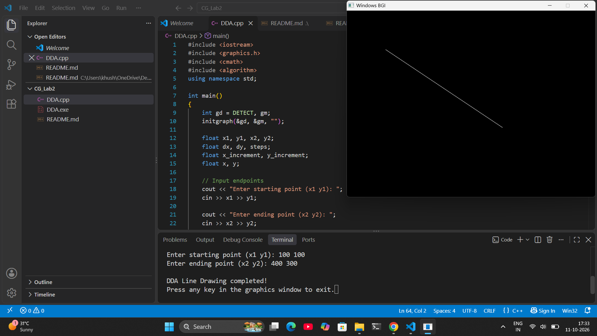

# CGM Lab Assignment 2 – DDA Line Drawing Algorithm

## Objective

To implement the Digital Differential Analyzer (DDA) Line Drawing Algorithm in C++ using the `graphics.h` library to draw a straight line between two user-defined points.

## Technologies Used

* **Programming Language:** C++
* **Graphics Library:** `graphics.h`
* **Header Files:** `iostream`, `graphics.h`, `cmath`, `algorithm`
* **IDE:** Visual Studio Code
* **Compiler:** GCC / MinGW

## Program Overview

The program accepts the starting point `(x1, y1)` and ending point `(x2, y2)` from the user.

It calculates the differences between the X and Y coordinates, determines the number of steps required, and calculates the X and Y increments.

The DDA algorithm then plots intermediate points using the `putpixel()` function. The `round()` function converts floating-point coordinates to the nearest integer before plotting each pixel.

If the starting and ending points are identical, the program plots a single pixel instead of performing the division by zero.

After drawing the line, the program displays a completion message and waits for a key press before closing the graphics window.

## Algorithm Formulas

The DDA algorithm uses the following formulas:

* `dx = x2 - x1`
* `dy = y2 - y1`
* `steps = max(abs(dx), abs(dy))`
* `x_increment = dx / steps`
* `y_increment = dy / steps`

The coordinates are updated at every step:

* `x = x + x_increment`
* `y = y + y_increment`

Each calculated point is plotted on the screen using `putpixel()`.

## Functions Used

| Function       | Description                                       |
| -------------- | ------------------------------------------------- |
| `initgraph()`  | Initializes graphics mode.                        |
| `max()`        | Finds the maximum absolute coordinate difference. |
| `abs()`        | Returns the absolute value of a difference.       |
| `setcolor()`   | Sets the drawing color to white.                  |
| `putpixel()`   | Plots a pixel at the specified coordinates.       |
| `round()`      | Rounds coordinates to the nearest integer.        |
| `getch()`      | Waits for a key press.                            |
| `closegraph()` | Closes the graphics mode.                         |

### Output Screenshot

## Learning Outcomes

After completing this assignment, the following concepts are successfully understood:
- Fundamentals of rasterization algorithms in computer graphics.
- Step-by-step implementation of the Digital Differential Analyzer (DDA) algorithm[cite: 5].
- Handling floating-point increments and pixel rounding.
- Integrating user input with graphical window rendering in C++.
